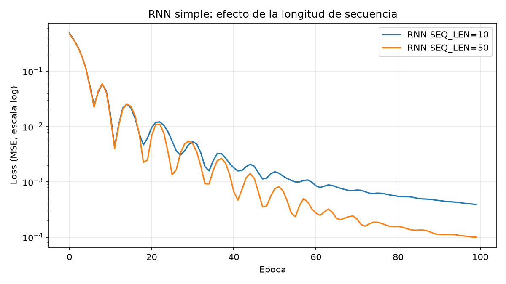
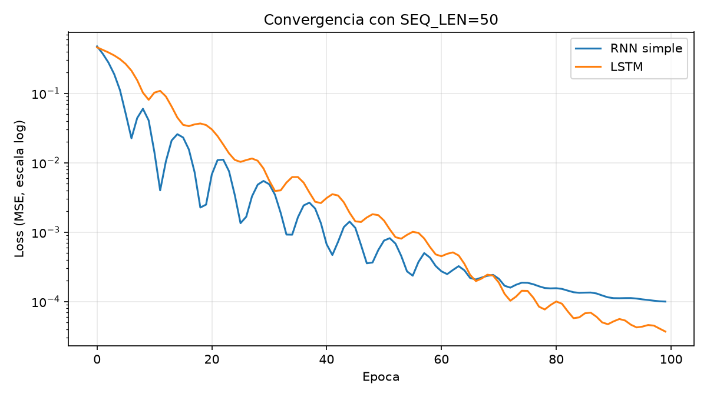
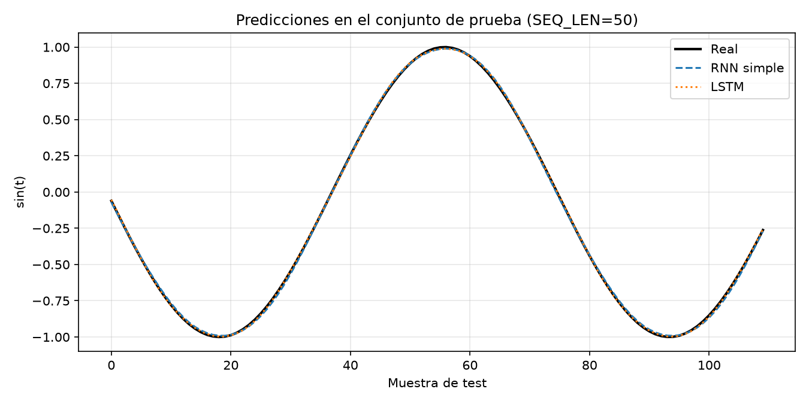

# Práctica 06: RNN simple vs LSTM en PyTorch

Predicción de una serie temporal sintética (`sin(t)`, `t ∈ [0, 50]`, 600 puntos) con dos arquitecturas recurrentes bajo el paradigma **Many-to-One**: dada una ventana de `SEQ_LEN` valores, se predice el siguiente.

## Estructura del repositorio
- `practica_rnn.py`: código completo (datos, modelos, actividades 1-3 y reto LSTM).
- `README.md`: este documento.
- `.gitignore`: excluye `venv/`, `__pycache__/`, `*.pyc`, `.vscode/`.
- `resultados.txt` y las gráficas `.png`: salidas generadas por el script.

## Ejecución
```bash
python -m venv venv
source venv/bin/activate        # Windows: venv\Scripts\activate
pip install torch matplotlib numpy
python practica_rnn.py
```

## Arquitectura implementada
Ambos modelos usan una capa recurrente (`nn.RNN` o `nn.LSTM`, `batch_first=True`, `hidden_size=16`) seguida de `nn.Linear(16, 1)` aplicada **solo al último paso temporal** (`out[:, -1, :]`).

| Parámetro | Valor |
|---|---|
| Pérdida / optimizador | MSE / Adam (lr = 0.01) |
| Épocas | 100 (lote completo) |
| Semilla | 42 (misma inicialización de datos en todos los experimentos) |
| Partición | 80 % entrenamiento / 20 % prueba, sin mezclar (respeta el orden temporal) |

La RNN simple actualiza `h_t = tanh(W_x·x_t + W_h·h_(t-1) + b)`. La LSTM añade una **celda de memoria** y tres compuertas (olvido, entrada y salida) que regulan qué se conserva y qué se descarta.

## Actividad 1: inspección de dimensiones
Con 600 puntos y `SEQ_LEN=10`: `X.shape = (590, 10, 1)` y `y.shape = (590, 1)`.

- **Eje 0, Batch Size (590):** número de ventanas, es decir `600 − SEQ_LEN`.
- **Eje 1, Sequence Length (10):** pasos temporales que recorre la red recurrente en cada ventana.
- **Eje 2, Features (1):** variables observadas por paso (aquí solo el valor de la senoide).

Con `SEQ_LEN=50`: `X.shape = (550, 50, 1)`. Para entrenamiento se usan 440 ventanas y para prueba 110.

## Actividad 2: parámetros entrenables según `hidden_size`
| hidden_size | RNN simple | LSTM |
|---|---|---|
| 16 | 321 | 1233 |
| 64 | 4353 | 17217 |

Fórmulas (con `in = 1`, y `h + 1` de la capa lineal de salida):
- RNN: `h·(in + h) + 2h`. Para h=16: 304 + 17 = 321.
- LSTM: `4·[h·(in + h) + 2h]`, porque tiene cuatro bloques de pesos (compuertas de olvido, entrada, salida y candidato de celda). Para h=16: 1216 + 17 = 1233.

Al pasar de 16 a 64 neuronas ocultas, los parámetros se multiplican por ~13.6 (RNN) y ~14.0 (LSTM): crecen de forma aproximadamente cuadrática con `h`, por el término `h²` de la matriz recurrente. La LSTM cuesta ~3.8 veces más parámetros que la RNN con el mismo `h`.

## Actividad 3: efecto de `SEQ_LEN` en la RNN simple (10 → 50)

| SEQ_LEN | Loss final (train) | MSE (test) |
|---|---|---|
| 10 | 0.000392 | 0.000402 |
| 50 | 0.000100 | 0.000111 |



**Análisis.** Contrario a lo que predice la teoría del gradiente desvanecido, en este experimento **alargar la ventana no empeoró la RNN: la mejoró** (el MSE de prueba bajó ~3.6 veces). No se observó "amnesia" ni estancamiento. Posibles razones:
- La senoide es una señal muy simple y suave. Con 50 pasos (≈ 4.2 rad, cerca de 2/3 de ciclo) la ventana contiene más información de fase y tendencia que con 10 pasos (≈ 0.8 rad), y para predecir el siguiente valor la información más útil sigue estando en los últimos pasos, que la RNN sí recuerda.
- 50 pasos todavía es una longitud moderada. El desvanecimiento severo del gradiente aparece con dependencias a más largo plazo o secuencias mucho más largas.

Sí se aprecia **inestabilidad en el entrenamiento** de la RNN: la pérdida oscila con picos (por ejemplo cerca de las épocas 8, 14, 22 y 36-50), con ambos valores de `SEQ_LEN`. Es esperable con lr = 0.01 y lote completo, y la curva con 50 pasos oscila de forma algo más marcada antes de estabilizarse hacia la época 80.

## Reto: RNN simple vs LSTM con `SEQ_LEN = 50`

| Modelo | Loss final (train) | MSE (test) |
|---|---|---|
| RNN simple | 0.000100 | 0.000111 |
| LSTM | 0.000037 | 0.000033 |




**Comparación de las curvas de convergencia.**
- **Inicio:** la RNN converge más rápido. Hacia la época 10 su pérdida era ≈ 0.041 frente a ≈ 0.081 de la LSTM, que arranca más lenta porque tiene más parámetros y compuertas que ajustar.
- **Estabilidad:** la curva de la RNN presenta oscilaciones y picos hasta cerca de la época 60, y luego se aplana alrededor de 1e-4 (épocas 80-100). La curva de la LSTM es más suave y sigue bajando de forma sostenida hasta el final.
- **Cruce:** alrededor de la época 65-70 la LSTM alcanza a la RNN y desde entonces la supera.
- **Resultado final:** la LSTM logra un MSE de prueba ≈ 3.4 veces menor (0.000033 frente a 0.000111). **La LSTM se ajusta mejor a la serie temporal.**
- **Predicciones:** en la gráfica, ambos modelos siguen la senoide real casi sin diferencia visible. La ventaja de la LSTM es cuantitativa (error), no visual.

## Conclusiones
1. La LSTM obtuvo el mejor ajuste con secuencias de 50 pasos y una convergencia más estable y sostenida, en línea con el papel de sus compuertas y su celda de memoria, que facilitan el flujo del gradiente. A cambio, necesita ~3.8 veces más parámetros y aprende más lento al inicio.
2. En este problema, la RNN simple **no mostró un colapso** por gradientes desvanecientes al pasar de 10 a 50 pasos; de hecho mejoró. Es importante no sobreinterpretar: la senoide es una tarea fácil.
3. **Limitaciones de este experimento:** una sola semilla y una sola corrida por modelo, 100 épocas, lote completo, y no se midió directamente la magnitud del gradiente. Además, parte de la ventaja de la LSTM podría deberse a su mayor capacidad (más parámetros) y no solo a sus compuertas. Para una conclusión más firme habría que repetir con varias semillas, igualar el número de parámetros y probar secuencias más largas (100-500 pasos) o señales con dependencias a largo plazo.

## Control de versiones
Commit inicial sugerido: `feat: implementacion inicial de RNN y LSTM en PyTorch para series temporales`.
